# Sprint 1 — Business Domain Design

## Sistem de Management al Sălii de Fitness

_Specificația cerințelor de business, modelul domeniului și regulile de afaceri_

|                  |                                                  |
| ---------------- | ------------------------------------------------ |
| **Baza de date** | PostgreSQL — `sala_fitness`                      |
| **Echipa**       | Acununei Marius Petrișor, Crăciun Andreea-Rebeca |
| **Data**         | Octombrie 2026                                   |

## Cuprins

- [Introducere](#introducere)
  - [Scopul documentului](#scopul-documentului)
  - [Contextul sistemului](#contextul-sistemului)
- [1. Business Requirements](#1-business-requirements)
  - [1.1 Actori](#11-actori)
  - [1.2 Catalogul use case-urilor](#12-catalogul-use-case-urilor)
  - [1.3 Diagrame Use Case](#13-diagrame-use-case)
  - [1.4 Specificații detaliate ale use case-urilor principale](#14-specificații-detaliate-ale-use-case-urilor-principale)
  - [1.5 Business Workflow](#15-business-workflow)
- [2. Domain Model](#2-domain-model)
  - [2.1 Entități de business](#21-entități-de-business)
  - [2.2 Asocieri](#22-asocieri)
  - [2.3 Diagrama de clase a entităților](#23-diagrama-de-clase-a-entităților)
  - [2.4 Modelul ORM (Object-Relational Mapping)](#24-modelul-orm-object-relational-mapping)
  - [2.5 Agregate (Entity Aggregates)](#25-agregate-entity-aggregates)
- [3. Business Rules](#3-business-rules)
  - [3.1 Reguli de validare la nivel de câmp](#31-reguli-de-validare-la-nivel-de-câmp)
  - [3.2 Reguli de validare la nivel de agregat](#32-reguli-de-validare-la-nivel-de-agregat)
  - [3.3 Reguli de calcul — câmpuri calculate](#33-reguli-de-calcul--câmpuri-calculate)
  - [3.4 Reguli de calcul — view-uri calculate](#34-reguli-de-calcul--view-uri-calculate)
- [4. Diagrama SQL (ERD)](#4-diagrama-sql-erd)
- [Anexa A. Codul SQL al view-urilor calculate](#anexa-a-codul-sql-al-view-urilor-calculate)
- [Anexa B. Triggere propuse pentru regulile de agregat și de calcul](#anexa-b-triggere-propuse-pentru-regulile-de-agregat-și-de-calcul)

---

# Introducere

## Scopul documentului

Documentul descrie componentele de business ale sistemului de management pentru o sală de fitness: cerințele de business (actori, use case-uri și fluxuri de lucru), modelul domeniului (entități, asocieri, model ORM, agregate și value objects) și regulile de business (reguli de validare, reguli de calcul și alte reguli).

Modelul este construit pe baza de date relațională **sala_fitness** (PostgreSQL), formată din 20 de tabele.

## Contextul sistemului

Sistemul gestionează activitatea zilnică a unei săli de fitness: înregistrarea clienților și vânzarea abonamentelor, controlul accesului în sală, programarea claselor de grup și a ședințelor de personal training, vânzarea de produse la recepție, evidența personalului (pontaj și salarii), mentenanța echipamentelor și colectarea feedback-ului de la clienți.

# 1. Business Requirements

Cerințele de business sunt exprimate prin use case-uri. Fiecare use case descrie o interacțiune cu valoare pentru un actor și este legat de entitățile din modelul domeniului pe care le folosește.

## 1.1 Actori

Actorii provin direct din structura bazei de date: tabela `utilizator` este specializată în `client` și `angajat`, iar rolul fiecărui angajat este dat de tabela `tip_angajat`.

**Tabelul 1.** _Actorii sistemului_

| Actor              | Tip             | Responsabilități                                                                                           | Corespondent în BD                              |
| ------------------ | --------------- | ---------------------------------------------------------------------------------------------------------- | ----------------------------------------------- |
| Client             | Principal, uman | Cumpără abonamente, intră în sală, rezervă clase, programează ședințe PT, cumpără produse, oferă feedback  | `client` (subtip al `utilizator`)               |
| Recepționer        | Principal, uman | Înregistrează clienți, vinde abonamente și produse, încasează plăți, gestionează accesul                   | `angajat` cu `tip_angajat` = Recepționer        |
| Antrenor           | Principal, uman | Ține clase de grup, marchează prezența, ține ședințe PT și consemnează observații                          | `angajat` cu `tip_angajat` = Antrenor           |
| Manager            | Principal, uman | Administrează personalul, tipurile de abonament, clasele, produsele și echipamentele; urmărește rapoartele | `angajat` cu `tip_angajat` = Manager            |
| Tehnician          | Principal, uman | Verifică și repară echipamentele, înregistrează intervențiile de mentenanță                                | `angajat` cu `tip_angajat` = Tehnic             |
| Femeie de serviciu | Secundar, uman  | Folosește sistemul doar pentru pontaj                                                                      | `angajat` cu `tip_angajat` = Femeie de serviciu |
| Angajat (generic)  | Abstract        | Comportament comun: autentificare, pontaj                                                                  | `angajat`                                       |

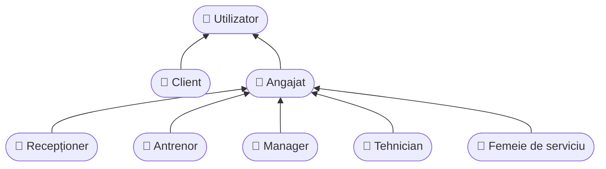

<p align="center"><b>Figura 1.</b> <i>Ierarhia actorilor (generalizare)</i></p>

## 1.2 Catalogul use case-urilor

**Tabelul 2.** _Catalogul use case-urilor_

| ID   | Use case                      | Actor principal      | Descriere                                                                  | Entități                             |
| ---- | ----------------------------- | -------------------- | -------------------------------------------------------------------------- | ------------------------------------ |
| UC01 | Înregistrare client           | Recepționer          | Creează contul de utilizator și profilul de client                         | utilizator, client                   |
| UC02 | Autentificare                 | Toți utilizatorii    | Autentificare cu email și parolă                                           | utilizator                           |
| UC03 | Achiziție abonament           | Recepționer, Client  | Vinde un abonament de un anumit tip și calculează perioada de valabilitate | abonamente_clienti, tipuri_abonament |
| UC04 | Înregistrare plată            | Recepționer          | Înregistrează încasarea (sumă, metodă, angajat)                            | plati                                |
| UC05 | Consultare abonament și plăți | Client               | Vede abonamentul curent, zilele rămase și istoricul plăților               | abonamente_clienti, plati            |
| UC06 | Acces în sală                 | Client, Recepționer  | Înregistrează intrarea și ieșirea din sală                                 | acces_sala                           |
| UC07 | Validare abonament activ      | Sistem (inclus)      | Verifică existența unui abonament valid la o dată                          | abonamente_clienti                   |
| UC08 | Vizualizare program clase     | Client               | Afișează sesiunile programate și locurile libere                           | program_clase, clase_fitness         |
| UC09 | Rezervare loc la clasă        | Client               | Rezervă un loc la o sesiune de clasă                                       | rezervari_clase                      |
| UC10 | Verificare capacitate         | Sistem (inclus)      | Verifică dacă mai există locuri libere                                     | clase_fitness, rezervari_clase       |
| UC11 | Anulare rezervare             | Client               | Anulează o rezervare înainte de începerea sesiunii                         | rezervari_clase                      |
| UC12 | Programare ședință PT         | Client, Antrenor     | Programează o ședință individuală cu un antrenor                           | sedinte_pt                           |
| UC13 | Acordare feedback             | Client               | Trimite un rating (1–5) și un comentariu                                   | feedback_clienti                     |
| UC14 | Vânzare produse               | Recepționer          | Vinde unul sau mai multe produse unui client                               | vanzari, linie_vanzare, produse      |
| UC15 | Marcare prezență la clasă     | Antrenor             | Marchează participanții unei sesiuni                                       | rezervari_clase                      |
| UC16 | Finalizare ședință PT         | Antrenor             | Setează statusul și notele ședinței                                        | sedinte_pt                           |
| UC17 | Pontaj check-in / check-out   | Angajat              | Înregistrează începutul și sfârșitul turei                                 | pontaj_angajati                      |
| UC18 | Calcul ore lucrate            | Sistem (inclus)      | Calculează orele prestate dintr-un pontaj                                  | pontaj_angajati                      |
| UC19 | Gestionare angajați           | Manager              | Adaugă/modifică angajați, funcții, salarii, program                        | angajat, tip_angajat                 |
| UC20 | Plată salarii                 | Manager              | Generează și confirmă plățile salariale lunare                             | salarii_istoric                      |
| UC21 | Gestionare tipuri abonament   | Manager              | Definește denumirea, durata și prețul abonamentelor                        | tipuri_abonament                     |
| UC22 | Definire clase și program     | Manager              | Definește clasele, antrenorul, capacitatea și orarul                       | clase_fitness, program_clase         |
| UC23 | Gestionare produse și stoc    | Manager, Recepționer | Adaugă produse, actualizează prețuri și stocuri                            | produse                              |
| UC24 | Gestionare echipamente        | Manager, Tehnician   | Evidența echipamentelor, locației și stării de uzură                       | echipamente_sala                     |
| UC25 | Înregistrare mentenanță       | Tehnician            | Înregistrează verificarea, problema și costul                              | mentenanta_echipamente               |

## 1.3 Diagrame Use Case

Pentru lizibilitate, use case-urile sunt împărțite în două diagrame: interacțiunile clienților cu recepția și antrenorii (Figura 2) și activitățile interne de personal și administrare (Figura 3). Relațiile `<<include>>` marchează pași obligatorii reutilizați (de exemplu, validarea abonamentului apare și la acces, și la rezervare), iar relațiile `<<extend>>` marchează comportamente opționale (înregistrarea unui client nou în timpul vânzării unui abonament).

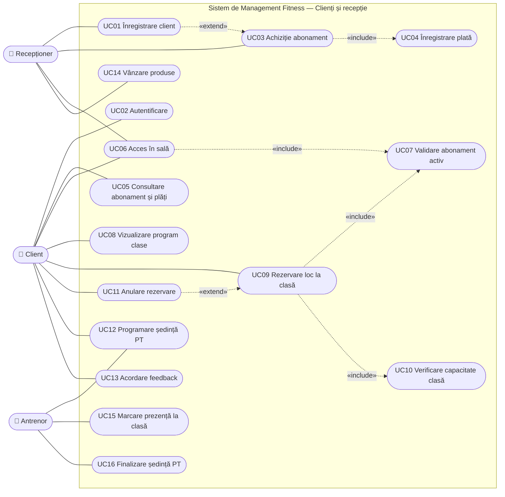

<p align="center"><b>Figura 2.</b> <i>Diagrama Use Case — clienți și recepție</i></p>

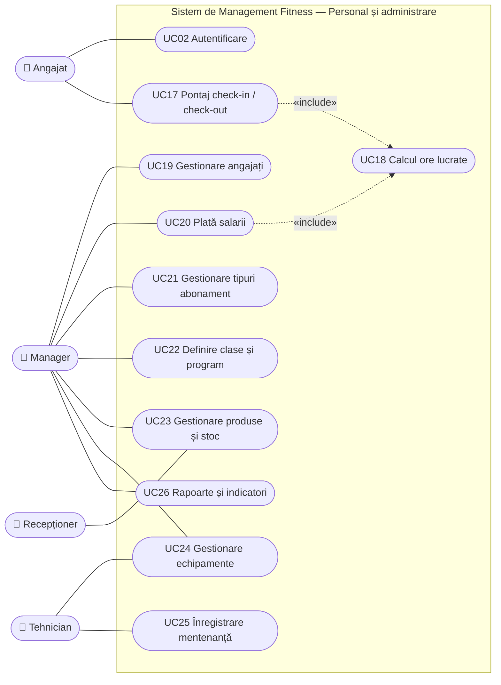

<p align="center"><b>Figura 3.</b> <i>Diagrama Use Case — personal și administrare</i></p>

## 1.4 Specificații detaliate ale use case-urilor principale

Use case-urile de mai jos sunt cele mai importante pentru afacere și aplică cele mai multe reguli de business.

### UC03 — Achiziție abonament

| Element                 | Descriere                                                                                                                                                                                                                                                                                                                                                                                                                                                                        |
| ----------------------- | -------------------------------------------------------------------------------------------------------------------------------------------------------------------------------------------------------------------------------------------------------------------------------------------------------------------------------------------------------------------------------------------------------------------------------------------------------------------------------- |
| **Actori**              | Recepționer (principal), Client                                                                                                                                                                                                                                                                                                                                                                                                                                                  |
| **Precondiții**         | Recepționerul este autentificat; tipul de abonament dorit există în `tipuri_abonament`.                                                                                                                                                                                                                                                                                                                                                                                          |
| **Declanșator**         | Clientul solicită un abonament la recepție.                                                                                                                                                                                                                                                                                                                                                                                                                                      |
| **Flux principal**      | 1. Recepționerul caută clientul după nume sau email.<br>2. Recepționerul selectează tipul de abonament.<br>3. Sistemul stabilește data de început: data curentă sau ziua de după expirarea abonamentului activ.<br>4. Sistemul calculează data de sfârșit și suma de plată (RC04, RC06).<br>5. Clientul plătește prin card, numerar sau transfer.<br>6. Sistemul înregistrează plata și abonamentul cu statusul „Activ” și actualizează tipul de abonament al clientului (RC10). |
| **Fluxuri alternative** | 1a. Clientul nu există: se execută UC01 (extend), apoi se continuă cu pasul 2.<br>5a. Plata eșuează: abonamentul nu se creează, iar tranzacția se anulează.                                                                                                                                                                                                                                                                                                                      |
| **Postcondiții**        | Există un abonament nou, nesuprapus cu cele existente (RA05), și o plată egală cu prețul tipului de abonament.                                                                                                                                                                                                                                                                                                                                                                   |
| **Reguli aplicate**     | RV08, RV09, RV13, RA05, RA06, RC04, RC05, RC06, RC10                                                                                                                                                                                                                                                                                                                                                                                                                             |

### UC06 — Acces în sală

| Element                 | Descriere                                                                                                                                                                                                                                                           |
| ----------------------- | ------------------------------------------------------------------------------------------------------------------------------------------------------------------------------------------------------------------------------------------------------------------- |
| **Actori**              | Client sau angajat (principal), Recepționer (secundar)                                                                                                                                                                                                              |
| **Precondiții**         | Utilizatorul are cont în sistem.                                                                                                                                                                                                                                    |
| **Declanșator**         | Utilizatorul se prezintă la intrarea în sală.                                                                                                                                                                                                                       |
| **Flux principal**      | 1. Sistemul identifică utilizatorul.<br>2. Pentru un client, sistemul verifică existența unui abonament valid la data curentă (UC07).<br>3. Sistemul înregistrează accesul cu statusul „Permis” și ora intrării.<br>4. La ieșire, sistemul completează ora ieșirii. |
| **Fluxuri alternative** | 2a. Utilizatorul este angajat: accesul este permis fără verificarea abonamentului.<br>2b. Nu există abonament valid: accesul este înregistrat cu statusul „Respins”, iar recepția propune un abonament (UC03).                                                      |
| **Postcondiții**        | Fiecare încercare de acces, permisă sau respinsă, este înregistrată în `acces_sala`.                                                                                                                                                                                |
| **Reguli aplicate**     | RV18, RA07                                                                                                                                                                                                                                                          |

### UC09 — Rezervare loc la clasă

| Element                 | Descriere                                                                                                                                                                                                                                                                                                   |
| ----------------------- | ----------------------------------------------------------------------------------------------------------------------------------------------------------------------------------------------------------------------------------------------------------------------------------------------------------- |
| **Actori**              | Client                                                                                                                                                                                                                                                                                                      |
| **Precondiții**         | Clientul este autentificat; sesiunea există în `program_clase`.                                                                                                                                                                                                                                             |
| **Declanșator**         | Clientul alege o sesiune din program (UC08).                                                                                                                                                                                                                                                                |
| **Flux principal**      | 1. Sistemul verifică că sesiunea nu a început.<br>2. Sistemul verifică abonamentul valid la data sesiunii (UC07).<br>3. Sistemul verifică dacă clientul are deja o rezervare la această sesiune.<br>4. Sistemul verifică locurile libere (UC10).<br>5. Sistemul creează rezervarea cu statusul „Confirmat”. |
| **Fluxuri alternative** | 1a / 2a / 3a. Una dintre verificări eșuează: rezervarea este refuzată cu mesajul corespunzător.<br>4a. Clasa este completă: rezervarea este refuzată.<br>5a. Clientul anulează ulterior (UC11): statusul devine „Anulat” și locul se eliberează.                                                            |
| **Postcondiții**        | Numărul de rezervări active nu depășește capacitatea clasei (RA01).                                                                                                                                                                                                                                         |
| **Reguli aplicate**     | RV16, RA01, RA02, RA03, RA04, RC09                                                                                                                                                                                                                                                                          |

### UC14 — Vânzare produse

| Element                 | Descriere                                                                                                                                                                                                                                                                                                                                                                        |
| ----------------------- | -------------------------------------------------------------------------------------------------------------------------------------------------------------------------------------------------------------------------------------------------------------------------------------------------------------------------------------------------------------------------------- |
| **Actori**              | Recepționer (principal), Client                                                                                                                                                                                                                                                                                                                                                  |
| **Precondiții**         | Recepționerul este autentificat; produsele există și au stoc.                                                                                                                                                                                                                                                                                                                    |
| **Declanșator**         | Clientul cumpără produse la recepție.                                                                                                                                                                                                                                                                                                                                            |
| **Flux principal**      | 1. Recepționerul deschide o vânzare pentru client.<br>2. Pentru fiecare produs se adaugă o linie cu cantitatea; prețul unitar se preia din prețul curent al produsului (RC07).<br>3. Sistemul calculează totalul liniei (RC01).<br>4. La finalizare, sistemul calculează totalul vânzării (RC02), salvează vânzarea și liniile într-o singură tranzacție și scade stocul (RC08). |
| **Fluxuri alternative** | 2a. Stoc insuficient: linia nu este adăugată.<br>4a. Vânzarea nu are nicio linie: nu poate fi finalizată (RA14).                                                                                                                                                                                                                                                                 |
| **Postcondiții**        | Vânzarea are cel puțin o linie, iar totalul ei este egal cu suma liniilor.                                                                                                                                                                                                                                                                                                       |
| **Reguli aplicate**     | RV19, RV20, RV21, RA11, RA14, RC01, RC02, RC07, RC08                                                                                                                                                                                                                                                                                                                             |

## 1.5 Business Workflow

Fluxurile de afaceri sunt modelate prin diagrame de activitate, cu culoare (swimlane) pentru fiecare actor, și prin diagrame de secvență pentru interacțiunile dintre obiectele domeniului. Au fost alese fluxurile care aplică cele mai multe reguli de business.

### Diagrame de activitate

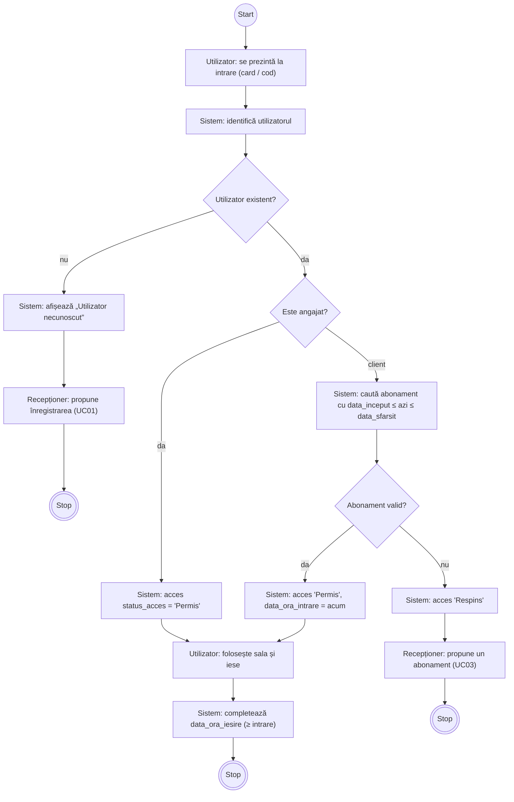

<p align="center"><b>Figura 4.</b> <i>Diagrama de activitate — accesul în sală</i></p>

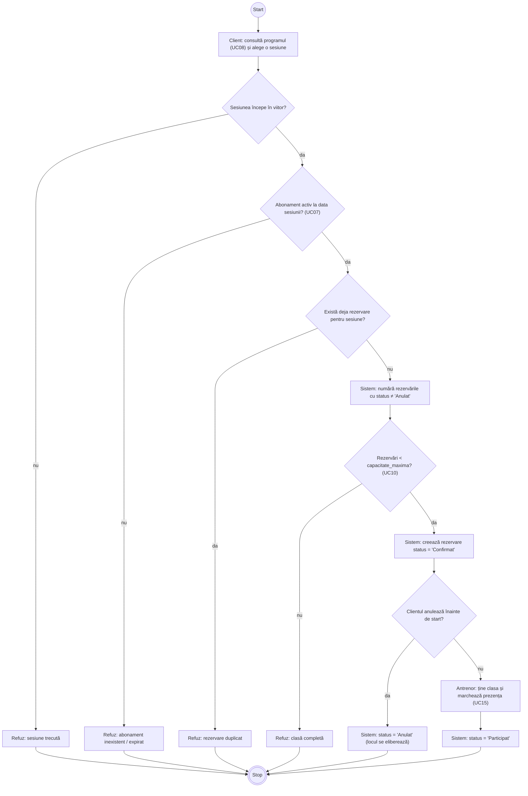

<p align="center"><b>Figura 5.</b> <i>Diagrama de activitate — rezervarea unui loc la o clasă</i></p>

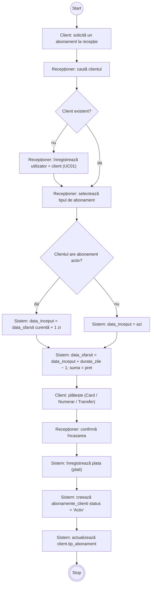

<p align="center"><b>Figura 6.</b> <i>Diagrama de activitate — achiziția unui abonament</i></p>

### Diagrame de secvență

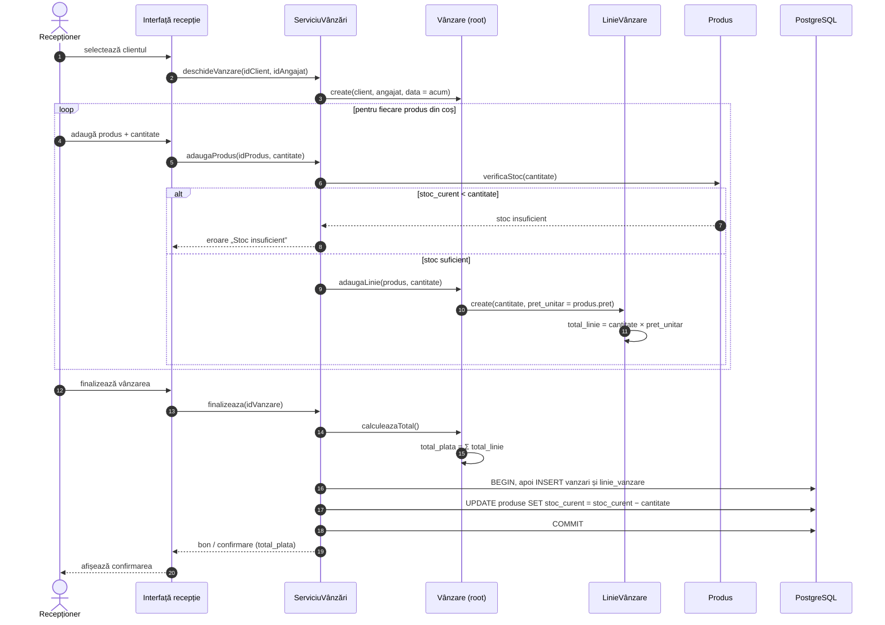

<p align="center"><b>Figura 7.</b> <i>Diagrama de secvență — vânzarea de produse</i></p>

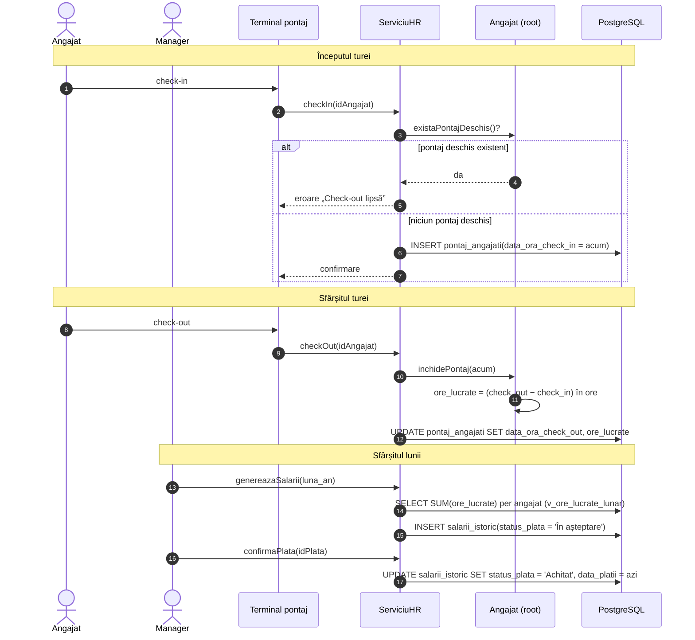

<p align="center"><b>Figura 8.</b> <i>Diagrama de secvență — pontajul și plata salariului</i></p>

---

# 2. Domain Model

## 2.1 Entități de business

Fiecare tabelă din baza de date corespunde unei clase din modelul domeniului. Numele claselor sunt la singular (de exemplu, `Vanzare` pentru tabela `vanzari`).

**Tabelul 3.** _Entitățile domeniului_

| Clasă de domeniu      | Tabelă                 | Descriere                                                                         |
| --------------------- | ---------------------- | --------------------------------------------------------------------------------- |
| Utilizator (abstract) | utilizator             | Date comune de identificare, autentificare și contact                             |
| Client                | client                 | Subtip al Utilizator: preferințe, contact de urgență, tipul abonamentului curent  |
| Angajat               | angajat                | Subtip al Utilizator: funcție, salariu, data angajării, program de lucru          |
| TipAngajat            | tip_angajat            | Nomenclator de roluri: Antrenor, Recepționer, Femeie de serviciu, Manager, Tehnic |
| PontajAngajat         | pontaj_angajati        | Înregistrarea check-in / check-out a unei ture                                    |
| SalariuIstoric        | salarii_istoric        | Plata salarială lunară a unui angajat                                             |
| TipAbonament          | tipuri_abonament       | Nomenclator: denumire, durată în zile, preț                                       |
| AbonamentClient       | abonamente_clienti     | Abonamentul cumpărat de un client, cu perioadă și status                          |
| Plata                 | plati                  | Încasarea unei sume de la un client, înregistrată de un angajat                   |
| ClasaFitness          | clase_fitness          | Tipul de clasă de grup, antrenorul titular și capacitatea maximă                  |
| ProgramClasa          | program_clase          | O sesiune concretă a unei clase: interval orar și sală                            |
| RezervareClasa        | rezervari_clase        | Rezervarea unui client la o sesiune                                               |
| SedintaPT             | sedinte_pt             | Ședință individuală antrenor–client                                               |
| AccesSala             | acces_sala             | O încercare de intrare în sală (permisă sau respinsă)                             |
| Echipament            | echipamente_sala       | Bun fizic din sală: denumire, locație, stare de uzură                             |
| MentenantaEchipament  | mentenanta_echipamente | Verificare sau reparație, cu cost și responsabil                                  |
| Produs                | produse                | Articol vândut la recepție: categorie, preț, stoc                                 |
| Vanzare               | vanzari                | Antetul unei tranzacții de vânzare                                                |
| LinieVanzare          | linie_vanzare          | Un produs din vânzare: cantitate, preț unitar, total                              |
| FeedbackClient        | feedback_clienti       | Recenzia unui client: rating și comentariu                                        |

## 2.2 Asocieri

**Tabelul 4.** _Asocierile dintre entități_

| Asociere                          | Multiplicitate      | Tip                                  | Implementare în BD                                                            |
| --------------------------------- | ------------------- | ------------------------------------ | ----------------------------------------------------------------------------- |
| Utilizator → Client / Angajat     | 1 — 0..1            | Moștenire (specializare disjunctă)   | PK partajată: `client.id_utilizator` și `angajat.id_utilizator` sunt PK și FK |
| TipAngajat — Angajat              | 1 — 0..\*           | Asociere (clasificare)               | `angajat.id_tip_angajat` FK, ON DELETE RESTRICT                               |
| Angajat ◆ PontajAngajat           | 1 — 0..\*           | Compoziție                           | `pontaj_angajati.id_utilizator_angajat` FK                                    |
| Angajat ◆ SalariuIstoric          | 1 — 0..\*           | Compoziție                           | `salarii_istoric.id_utilizator_angajat` FK                                    |
| Client ◆ AbonamentClient          | 1 — 0..\*           | Compoziție                           | `abonamente_clienti.id_utilizator_client` FK                                  |
| TipAbonament — AbonamentClient    | 1 — 0..\*           | Asociere                             | `abonamente_clienti.id_tip_abonament` FK                                      |
| Client — Plata — Angajat          | 1 — 0.._ / 1 — 0.._ | Asocieri (plătitor / încasator)      | `plati.id_utilizator_client`, `plati.id_utilizator_angajat`                   |
| Angajat (antrenor) — ClasaFitness | 1 — 0..\*           | Asociere                             | `clase_fitness.id_utilizator_antrenor` FK                                     |
| ClasaFitness ◆ ProgramClasa       | 1 — 0..\*           | Compoziție                           | `program_clase.id_clasa` FK                                                   |
| ProgramClasa ◆ RezervareClasa     | 1 — 0..\*           | Compoziție                           | `rezervari_clase.id_program` FK                                               |
| Client — RezervareClasa           | 1 — 0..\*           | Asociere                             | `rezervari_clase.id_utilizator_client` FK + UNIQUE(client, program)           |
| Client — SedintaPT — Angajat      | 1 — 0.._ / 1 — 0.._ | Asociere ternară (clasă de asociere) | `sedinte_pt.id_utilizator_client`, `id_utilizator_antrenor`                   |
| Utilizator — AccesSala            | 1 — 0..\*           | Asociere                             | `acces_sala.id_utilizator` FK                                                 |
| Echipament ◆ MentenantaEchipament | 1 — 0..\*           | Compoziție                           | `mentenanta_echipamente.id_echipament` FK                                     |
| Angajat — MentenantaEchipament    | 1 — 0..\*           | Asociere (responsabil)               | `id_angajat_responsabil` FK                                                   |
| Client — Vanzare — Angajat        | 1 — 0.._ / 1 — 0.._ | Asocieri (cumpărător / vânzător)     | `vanzari.id_utilizator_client`, `id_utilizator_angajat`                       |
| Vanzare ◆ LinieVanzare            | 1 — 1..\*           | Compoziție                           | `linie_vanzare.id_vanzare` FK, ON DELETE CASCADE                              |
| Produs — LinieVanzare             | 1 — 0..\*           | Asociere                             | `linie_vanzare.id_produs` FK                                                  |
| Client ◆ FeedbackClient           | 1 — 0..\*           | Compoziție                           | `feedback_clienti.id_utilizator_client` FK, ON DELETE CASCADE                 |

## 2.3 Diagrama de clase a entităților

Diagrama de clase de mai jos prezintă toate entitățile domeniului, cu atributele și tipurile lor (value objects și enumerări) și metodele de business. Câmpurile calculate (`oreLucrate`, `totalLinie`, `totalPlata`, `locuriDisponibile`) sunt descrise în secțiunea 3.3. Compozițiile (romb plin) marchează entitățile componente ale agregatelor.

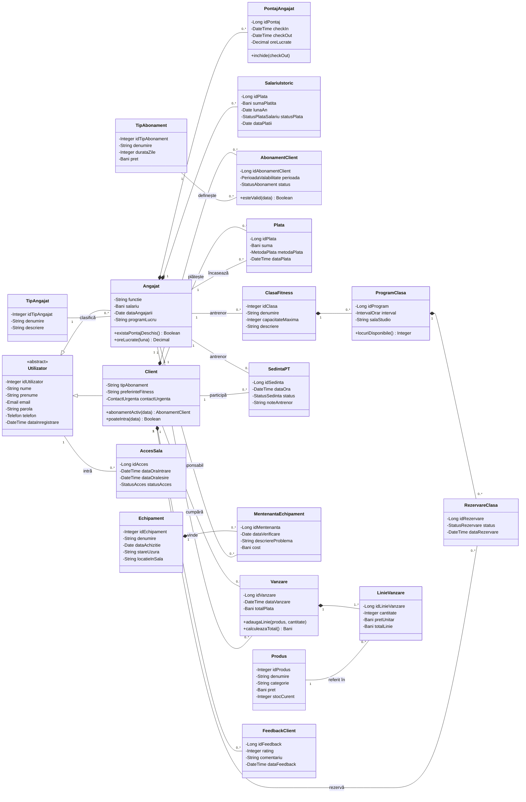

<p align="center"><b>Figura 9.</b> <i>Diagrama de clase a entităților de domeniu</i></p>

## 2.4 Modelul ORM (Object-Relational Mapping)

Modelul ORM descrie felul în care conceptele orientate-obiect din diagrama de clase sunt reprezentate în schema relațională PostgreSQL. Regulile de mapare de mai jos sunt aplicate uniform pe toate cele 20 de entități.

**Tabelul 5.** _Regulile de mapare obiect-relațional_

| Concept OO               | Mapare relațională                                                                                                                               | Exemplu din model                                       |
| ------------------------ | ------------------------------------------------------------------------------------------------------------------------------------------------ | ------------------------------------------------------- |
| Clasă de entitate        | O tabelă; numele la plural sau descriptiv, cu litere mici și underscore                                                                          | Vanzare → `vanzari`                                     |
| Identitate               | Cheie surogat `GENERATED BY DEFAULT AS IDENTITY`; INTEGER pentru nomenclatoare, BIGINT pentru tranzacții                                         | `id_vanzare BIGINT`                                     |
| Moștenire                | Class Table Inheritance (strategia JOINED): tabelă pentru superclasă și câte o tabelă pentru fiecare subclasă, cu PK = FK către părinte          | `utilizator` ← `client`, `angajat`                      |
| Asociere 1 — 0..\*       | Cheie străină NOT NULL în tabela din partea „mulți”                                                                                              | `plati.id_utilizator_client`                            |
| Compoziție               | FK NOT NULL către rădăcină; ON DELETE CASCADE când componenta nu are sens fără părinte, RESTRICT când componenta este istoric ce trebuie păstrat | `linie_vanzare` (CASCADE), `pontaj_angajati` (RESTRICT) |
| Asociere M:N cu atribute | Tabelă de asociere cu PK proprie și două FK                                                                                                      | `rezervari_clase`, `sedinte_pt`                         |
| Value object             | Coloane încorporate (embedded) în tabela entității, fără tabelă proprie                                                                          | PerioadaValabilitate → `data_inceput`, `data_sfarsit`   |
| Enumerare                | VARCHAR cu constrângere CHECK pe lista de valori                                                                                                 | `status_acces IN ('Permis','Respins')`                  |
| Bani                     | NUMERIC(10,2) cu CHECK ≥ 0                                                                                                                       | `pret`, `suma`, `cost`                                  |
| Atribut calculat         | Coloană stocată, actualizată prin logica aplicației sau trigger, ori calculată la citire într-un view                                            | `total_linie`, `v_ocupare_clase`                        |
| Navigare între agregate  | Doar prin identificator (FK), fără încărcarea agregatului țintă                                                                                  | `Vanzare` reține `id_utilizator_client`                 |

În cod, strategia JOINED corespunde, de exemplu, adnotării `@Inheritance(strategy = InheritanceType.JOINED)` în JPA/Hibernate sau moștenirii „joined table” din SQLAlchemy și Entity Framework (TPT). Value objects se mapează ca `@Embeddable`, iar enumerările ca `@Enumerated(EnumType.STRING)`.

## 2.5 Agregate (Entity Aggregates)

Un agregat este un grup de entități tratate ca o unitate de consistență: modificările se fac numai prin entitatea rădăcină (root), care protejează invarianții grupului. Între agregate se fac referințe doar prin identificator. Delimitarea de mai jos respectă tranzacțiile reale ale afacerii (o vânzare, o rezervare, un pontaj).

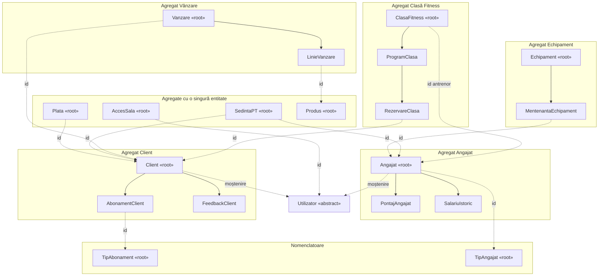

<p align="center"><b>Figura 10.</b> <i>Agregatele domeniului și referințele prin identificator</i></p>

# 3. Business Rules

Regulile sunt grupate după cerința Sprint 1: reguli de validare (la nivel de câmp și la nivel de agregat), reguli de calcul (câmpuri calculate și view-uri calculate) și alte reguli. Pentru fiecare regulă se precizează unde este implementată: în baza de date (constrângere), în aplicație sau printr-un trigger propus.

## 3.1 Reguli de validare la nivel de câmp

**Tabelul 6.** _Reguli de validare ale câmpurilor_

| Cod  | Entitate / câmp                                 | Regulă                                                                | Implementare                         |
| ---- | ----------------------------------------------- | --------------------------------------------------------------------- | ------------------------------------ |
| RV01 | utilizator.email                                | Obligatoriu, unic, format valid de email                              | NOT NULL, UNIQUE; format: aplicație  |
| RV02 | utilizator.nume, prenume                        | Obligatorii, maximum 100 de caractere                                 | NOT NULL, VARCHAR(100)               |
| RV03 | utilizator.parola                               | Obligatorie; se stochează doar hash-ul parolei, niciodată textul clar | NOT NULL; hash: aplicație            |
| RV04 | utilizator.data_inregistrare                    | Completată automat la creare                                          | DEFAULT CURRENT_TIMESTAMP            |
| RV05 | angajat.salariu                                 | Valoare ≥ 0, implicit 0                                               | CHECK chk_angajat_salariu            |
| RV06 | angajat.functie, data_angajarii, id_tip_angajat | Obligatorii                                                           | NOT NULL                             |
| RV07 | tip_angajat.denumire, tipuri_abonament.denumire | Denumiri unice în nomenclator                                         | UNIQUE                               |
| RV08 | tipuri_abonament.durata_zile, pret              | Durată > 0 zile; preț ≥ 0                                             | CHECK chk_abonament_durata / \_pret  |
| RV09 | abonamente_clienti.data_sfarsit                 | Nu poate fi înaintea datei de început                                 | CHECK chk_abonament_interval         |
| RV10 | abonamente_clienti.status                       | Valori permise: Activ, Expirat                                        | Aplicație (CHECK propus)             |
| RV11 | pontaj_angajati                                 | Check-out ≥ check-in sau necompletat; ore lucrate ≥ 0                 | CHECK chk_pontaj_interval / \_ore    |
| RV12 | salarii_istoric                                 | Suma ≥ 0; status ∈ {Achitat, În așteptare}, implicit „În așteptare”   | CHECK chk_salariu_status / \_suma    |
| RV13 | plati.suma, metoda_plata                        | Suma ≥ 0; metoda ∈ {Card, Numerar, Transfer}                          | CHECK pe sumă; metodă: aplicație     |
| RV14 | clase_fitness.capacitate_maxima                 | Capacitate > 0                                                        | CHECK chk_clasa_capacitate           |
| RV15 | program_clase                                   | Ora de sfârșit > ora de început; sala obligatorie                     | CHECK chk_program_interval, NOT NULL |
| RV16 | rezervari_clase.status                          | Valori: Confirmat, Anulat, Participat; implicit Confirmat             | CHECK chk_rezervare_status           |
| RV17 | sedinte_pt.status                               | Valori: Programat, Finalizat, Anulat, Absent                          | Aplicație (CHECK propus)             |
| RV18 | acces_sala                                      | Status ∈ {Permis, Respins}; ieșire ≥ intrare sau necompletată         | CHECK chk_acces_status / \_interval  |
| RV19 | produse.pret, stoc_curent                       | Preț ≥ 0; stoc ≥ 0                                                    | CHECK chk_produs_pret / \_stoc       |
| RV20 | linie_vanzare                                   | Cantitate > 0; preț unitar ≥ 0; total ≥ 0                             | CHECK chk*linie*\*                   |
| RV21 | vanzari.total_plata                             | Total ≥ 0                                                             | CHECK chk_vanzare_total              |
| RV22 | mentenanta_echipamente.cost                     | Cost ≥ 0, implicit 0                                                  | CHECK chk_mentenanta_cost            |
| RV23 | feedback_clienti.rating                         | Număr întreg între 1 și 5                                             | CHECK chk_feedback_rating            |

## 3.2 Reguli de validare la nivel de agregat

Aceste reguli implică mai multe înregistrări sau mai multe entități și nu pot fi exprimate printr-o simplă constrângere CHECK pe un rând. Ele sunt invarianții protejați de rădăcinile agregatelor (secțiunea 2.5).

**Tabelul 7.** _Reguli de validare ale agregatelor_

| Cod  | Agregat            | Regulă                                                                                                                                                         | Implementare                           |
| ---- | ------------------ | -------------------------------------------------------------------------------------------------------------------------------------------------------------- | -------------------------------------- |
| RA01 | Clasă Fitness      | Numărul rezervărilor neanulate ale unei sesiuni nu poate depăși `capacitate_maxima` a clasei.                                                                  | Aplicație; trigger propus T1 (Anexa B) |
| RA02 | Clasă Fitness      | Un client are cel mult o rezervare pentru aceeași sesiune.                                                                                                     | UNIQUE uq_rezervare_client_program     |
| RA03 | Clasă Fitness      | Rezervarea se face doar pentru sesiuni viitoare și doar dacă clientul are abonament valid la data sesiunii.                                                    | Aplicație                              |
| RA04 | Clasă Fitness      | Anularea este permisă doar înainte de începerea sesiunii; statusul „Participat” se setează de antrenor doar după începere.                                     | Aplicație                              |
| RA05 | Client             | Perioadele abonamentelor aceluiași client nu se suprapun.                                                                                                      | Aplicație; EXCLUDE propus (cap. 5)     |
| RA06 | Client             | Durata abonamentului respectă tipul ales: `data_sfarsit = data_inceput + durata_zile − 1`.                                                                     | Aplicație                              |
| RA07 | Acces sală         | Un client primește statusul „Permis” doar dacă are un abonament cu `data_inceput ≤ data intrării ≤ data_sfarsit`; altfel „Respins”. Angajații au acces permis. | Aplicație                              |
| RA08 | Angajat            | Un angajat nu poate face check-in cât timp are un pontaj deschis (fără check-out).                                                                             | Aplicație                              |
| RA09 | Ședință PT / Clasă | Antrenorul unei clase sau al unei ședințe PT trebuie să fie angajat cu tipul „Antrenor”.                                                                       | Aplicație (FK nu poate impune rolul)   |
| RA10 | Echipament         | Responsabilul unei intervenții de mentenanță trebuie să fie angajat cu tipul „Tehnic”.                                                                         | Aplicație                              |
| RA11 | Vânzare / Plată    | Vânzările și plățile sunt înregistrate de un angajat cu tipul „Recepționer”.                                                                                   | Aplicație                              |
| RA12 | Clasă Fitness      | Două sesiuni din aceeași sală/studio nu se pot suprapune în timp.                                                                                              | Aplicație                              |
| RA13 | Ședință PT         | Un antrenor nu poate avea două ședințe PT neanulate la aceeași oră.                                                                                            | Aplicație                              |
| RA14 | Vânzare            | O vânzare are cel puțin o linie, iar cantitatea vândută nu depășește stocul disponibil.                                                                        | Aplicație + CHECK stoc ≥ 0             |

## 3.3 Reguli de calcul — câmpuri calculate

**Tabelul 8.** _Câmpuri calculate_

| Cod  | Câmp                            | Formulă / logică                                                                             |
| ---- | ------------------------------- | -------------------------------------------------------------------------------------------- |
| RC01 | linie_vanzare.total_linie       | `cantitate × pret_unitar`                                                                    |
| RC02 | vanzari.total_plata             | `Σ total_linie` al liniilor vânzării                                                         |
| RC03 | pontaj_angajati.ore_lucrate     | `(check_out − check_in)` în ore, rotunjit la 2 zecimale                                      |
| RC04 | abonamente_clienti.data_sfarsit | `data_inceput + durata_zile − 1`                                                             |
| RC05 | abonamente_clienti.status       | „Activ” dacă data curentă ≤ `data_sfarsit`, altfel „Expirat”                                 |
| RC06 | plati.suma                      | Egală cu `tipuri_abonament.pret` la momentul achiziției                                      |
| RC07 | linie_vanzare.pret_unitar       | Copia prețului curent al produsului la momentul vânzării (snapshot)                          |
| RC08 | produse.stoc_curent             | Scade cu cantitatea vândută la finalizarea vânzării                                          |
| RC09 | Locuri libere (nestocat)        | `capacitate_maxima − nr. rezervări neanulate`                                                |
| RC10 | client.tip_abonament            | Denumirea tipului ultimului abonament cumpărat                                               |
| RC11 | salarii_istoric.suma_platita    | Salariul lunar valabil la data plății; nu se recalculează când salariul se modifică ulterior |

## 3.4 Alte reguli de business

**Tabelul 9.** _Alte reguli de business_

| Cod  | Regulă                                                                                                                                                                                      | Implementare                         |
| ---- | ------------------------------------------------------------------------------------------------------------------------------------------------------------------------------------------- | ------------------------------------ |
| RB01 | Păstrarea istoricului: entitățile cu istoric financiar sau operațional (plăți, vânzări, pontaje, salarii, rezervări, accese, ședințe, intervenții) nu pot fi șterse cât timp sunt referite. | ON DELETE RESTRICT                   |
| RB02 | Ștergerea unui utilizator șterge automat profilul de client sau de angajat; ștergerea unei vânzări îi șterge liniile; ștergerea unui client îi șterge recenziile.                           | ON DELETE CASCADE                    |
| RB03 | Modificarea unei chei primare se propagă în toate tabelele dependente.                                                                                                                      | ON UPDATE CASCADE pe toate FK        |
| RB04 | Trasabilitate: fiecare plată, vânzare și intervenție reține angajatul care a efectuat-o.                                                                                                    | FK obligatorii către `angajat`       |
| RB05 | O plată salarială cu statusul „Achitat” are obligatoriu data plății; istoricul salarial nu se modifică retroactiv.                                                                          | Aplicație                            |
| RB06 | Prețurile din nomenclatoare se pot modifica fără a afecta tranzacțiile trecute, care păstrează prețul din momentul tranzacției.                                                             | Snapshot (RC06, RC07)                |
| RB07 | Datele personale (telefon, contact de urgență) sunt accesibile doar personalului autorizat (protecția datelor, GDPR).                                                                       | Aplicație / roluri BD                |
| RB08 | Client și Angajat sunt specializări disjuncte: un utilizator are un singur profil.                                                                                                          | Aplicație (verificat: 0 suprapuneri) |

---

# 4. Diagrama SQL (ERD)

Diagrama entitate-relație a fost generată automat din catalogul bazei de date (`information_schema`), deci reflectă exact structura implementată: 20 de tabele și 25 de chei străine. Notația este crow’s foot: o linie dublă înseamnă exact unu, „cercul + furculița” înseamnă zero sau mai mulți, iar „cercul + linia” zero sau unu (relația de moștenire utilizator → client / angajat). Coloanele marcate PK sunt chei primare, iar cele marcate FK sunt chei străine.

```mermaid
erDiagram
    utilizator ||--o{ acces_sala : "id_utilizator"
    utilizator ||--o| angajat : "id_utilizator"
    tip_angajat ||--o{ angajat : "id_tip_angajat"
    angajat ||--o{ clase_fitness : "id_utilizator_antrenor"
    clase_fitness ||--o{ program_clase : "id_clasa"
    client ||--o{ feedback_clienti : "id_utilizator_client"
    vanzari ||--o{ linie_vanzare : "id_vanzare"
    produse ||--o{ linie_vanzare : "id_produs"
    echipamente_sala ||--o{ mentenanta_echipamente : "id_echipament"
    angajat ||--o{ mentenanta_echipamente : "id_angajat_responsabil"
    angajat ||--o{ pontaj_angajati : "id_utilizator_angajat"
    client ||--o{ plati : "id_utilizator_client"
    angajat ||--o{ plati : "id_utilizator_angajat"
    client ||--o{ sedinte_pt : "id_utilizator_client"
    angajat ||--o{ sedinte_pt : "id_utilizator_antrenor"
    angajat ||--o{ salarii_istoric : "id_utilizator_angajat"
    program_clase ||--o{ rezervari_clase : "id_program"
    client ||--o{ rezervari_clase : "id_utilizator_client"
    utilizator ||--o| client : "id_utilizator"
    client ||--o{ vanzari : "id_utilizator_client"
    angajat ||--o{ vanzari : "id_utilizator_angajat"
    tipuri_abonament ||--o{ abonamente_clienti : "id_tip_abonament"
    client ||--o{ abonamente_clienti : "id_utilizator_client"
    abonamente_clienti {
        bigint id_abonament_client PK
        int id_utilizator_client FK
        int id_tip_abonament FK
        date data_inceput
        date data_sfarsit
        varchar status
    }
    acces_sala {
        bigint id_acces PK
        int id_utilizator FK
        timestamp data_ora_intrare
        timestamp data_ora_iesire
        varchar status_acces
    }
    angajat {
        int id_utilizator PK,FK
        int id_tip_angajat FK
        varchar functie
        numeric salariu
        date data_angajarii
        varchar program_lucru
    }
    clase_fitness {
        int id_clasa PK
        varchar denumire
        int id_utilizator_antrenor FK
        int capacitate_maxima
        text descriere
    }
    client {
        int id_utilizator PK,FK
        varchar tip_abonament
        text preferinte_fitness
        varchar contact_urgenta
    }
    echipamente_sala {
        int id_echipament PK
        varchar denumire
        date data_achizitie
        varchar stare_uzura
        varchar locatie_in_sala
    }
    feedback_clienti {
        bigint id_feedback PK
        int id_utilizator_client FK
        int rating
        text comentariu
        timestamp data_feedback
    }
    linie_vanzare {
        bigint id_linie_vanzare PK
        bigint id_vanzare FK
        int id_produs FK
        int cantitate
        numeric pret_unitar
        numeric total_linie
    }
    mentenanta_echipamente {
        bigint id_mentenanta PK
        int id_echipament FK
        date data_verificare
        text descriere_problema
        numeric cost
        int id_angajat_responsabil FK
    }
    plati {
        bigint id_plata PK
        int id_utilizator_client FK
        int id_utilizator_angajat FK
        numeric suma
        varchar metoda_plata
        timestamp data_plata
    }
    pontaj_angajati {
        bigint id_pontaj PK
        int id_utilizator_angajat FK
        timestamp data_ora_check_in
        timestamp data_ora_check_out
        numeric ore_lucrate
    }
    produse {
        int id_produs PK
        varchar denumire
        varchar categorie
        numeric pret
        int stoc_curent
    }
    program_clase {
        bigint id_program PK
        int id_clasa FK
        timestamp data_ora_inceput
        timestamp data_ora_sfarsit
        varchar sala_studio
    }
    rezervari_clase {
        bigint id_rezervare PK
        int id_utilizator_client FK
        bigint id_program FK
        varchar status
        timestamp data_rezervare
    }
    salarii_istoric {
        bigint id_plata PK
        int id_utilizator_angajat FK
        numeric suma_platita
        date luna_an
        varchar status_plata
        date data_platii
    }
    sedinte_pt {
        bigint id_sedinta PK
        int id_utilizator_antrenor FK
        int id_utilizator_client FK
        timestamp data_ora
        varchar status
        text note_antrenor
    }
    tip_angajat {
        int id_tip_angajat PK
        varchar denumire
        text descriere
    }
    tipuri_abonament {
        int id_tip_abonament PK
        varchar denumire
        int durata_zile
        numeric pret
    }
    utilizator {
        int id_utilizator PK
        varchar nume
        varchar prenume
        varchar email
        varchar parola
        varchar telefon
        timestamp data_inregistrare
    }
    vanzari {
        bigint id_vanzare PK
        int id_utilizator_client FK
        int id_utilizator_angajat FK
        timestamp data_vanzare
        numeric total_plata
    }
```

<p align="center"><b>Figura 11.</b> <i>Diagrama ERD a bazei de date sala_fitness</i></p>

# Anexa A. Codul SQL al view-urilor calculate

Scriptul a fost rulat pe baza de date populată (PostgreSQL 16). Poate fi executat direct în DBeaver sau pgAdmin.

```sql
-- V1. Abonamentele valabile la data curentă
CREATE OR REPLACE VIEW v_abonamente_active AS
SELECT
    ac.id_abonament_client,
    u.id_utilizator,
    u.nume || ' ' || u.prenume AS client,
    ta.denumire AS tip_abonament,
    ac.data_inceput,
    ac.data_sfarsit,
    (ac.data_sfarsit - CURRENT_DATE) AS zile_ramase
FROM abonamente_clienti ac
JOIN utilizator u ON u.id_utilizator = ac.id_utilizator_client
JOIN tipuri_abonament ta ON ta.id_tip_abonament = ac.id_tip_abonament
WHERE CURRENT_DATE BETWEEN ac.data_inceput AND ac.data_sfarsit;

-- V2. Gradul de ocupare al fiecărei sesiuni de clasă
CREATE OR REPLACE VIEW v_ocupare_clase AS
SELECT
    pc.id_program,
    cf.denumire AS clasa,
    pc.data_ora_inceput,
    pc.sala_studio,
    cf.capacitate_maxima,
    COUNT(r.id_rezervare) FILTER (WHERE r.status <> 'Anulat') AS locuri_ocupate,
    cf.capacitate_maxima - COUNT(r.id_rezervare) FILTER (WHERE r.status <> 'Anulat') AS locuri_libere,
    ROUND(100.0 * COUNT(r.id_rezervare) FILTER (WHERE r.status <> 'Anulat') / cf.capacitate_maxima, 1) AS grad_ocupare_pct
FROM program_clase pc
JOIN clase_fitness cf ON cf.id_clasa = pc.id_clasa
LEFT JOIN rezervari_clase r ON r.id_program = pc.id_program
GROUP BY
    pc.id_program,
    cf.denumire,
    pc.data_ora_inceput,
    pc.sala_studio,
    cf.capacitate_maxima;

-- V3. Veniturile lunare (abonamente - produse)
CREATE OR REPLACE VIEW v_venituri_lunare AS
WITH ab AS (
    SELECT date_trunc('month', data_plata)::date AS luna, SUM(suma) AS venit
    FROM plati
    GROUP BY 1
),
pr AS (
    SELECT date_trunc('month', data_vanzare)::date AS luna, SUM(total_plata) AS venit
    FROM vanzari
    GROUP BY 1
)
SELECT
    COALESCE(ab.luna, pr.luna) AS luna,
    COALESCE(ab.venit, 0) AS venit_abonamente,
    COALESCE(pr.venit, 0) AS venit_produse,
    COALESCE(ab.venit, 0) + COALESCE(pr.venit, 0) AS venit_total
FROM ab
FULL JOIN pr ON pr.luna = ab.luna;

-- V4. Orele lucrate lunar de fiecare angajat
CREATE OR REPLACE VIEW v_ore_lucrate_lunar AS
SELECT
    a.id_utilizator,
    u.nume || ' ' || u.prenume AS angajat,
    ta.denumire AS tip_angajat,
    date_trunc('month', p.data_ora_check_in)::date AS luna,
    COUNT(*) AS zile_pontate,
    SUM(p.ore_lucrate) AS total_ore
FROM pontaj_angajati p
JOIN angajat a ON a.id_utilizator = p.id_utilizator_angajat
JOIN utilizator u ON u.id_utilizator = a.id_utilizator
JOIN tip_angajat ta ON ta.id_tip_angajat = a.id_tip_angajat
WHERE p.data_ora_check_out IS NOT NULL
GROUP BY
    a.id_utilizator,
    u.nume,
    u.prenume,
    ta.denumire,
    date_trunc('month', p.data_ora_check_in);

-- V5. Costul de mentenanță pe echipament
CREATE OR REPLACE VIEW v_cost_mentenanta_echipament AS
SELECT
    e.id_echipament,
    e.denumire,
    e.stare_uzura,
    COUNT(m.id_mentenanta) AS nr_interventii,
    COALESCE(SUM(m.cost), 0) AS cost_total,
    MAX(m.data_verificare) AS ultima_verificare
FROM echipamente_sala e
LEFT JOIN mentenanta_echipamente m ON m.id_echipament = e.id_echipament
GROUP BY
    e.id_echipament,
    e.denumire,
    e.stare_uzura;

-- V6. Indicatori de satisfacție lunari
CREATE OR REPLACE VIEW v_feedback_lunar AS
SELECT
    date_trunc('month', data_feedback)::date AS luna,
    COUNT(*) AS nr_recenzii,
    ROUND(AVG(rating), 2) AS rating_mediu,
    COUNT(*) FILTER (WHERE rating < 2) AS recenzii_negative
FROM feedback_clienti
GROUP BY 1;
```

---

# Anexa B. Triggere propuse pentru regulile de agregat și de calcul

Triggerele au fost testate într-o tranzacție anulată ulterior (`ROLLBACK`), deci datele nu au fost modificate. Rezultatele testelor: T2 a calculat 8,50 ore pentru o tură 07:00–15:30; T3 a calculat automat totalul de 55,50 RON pentru o vânzare cu 3 × 10,00 + 1 × 25,50; T1 a respins a 13-a rezervare la o sesiune cu 12 locuri, cu mesajul „Clasa este completă (12 / 12 locuri)”.

```sql
-- T1. Capacitatea maximă a unei sesiuni de clasă (regula RA01)
CREATE OR REPLACE FUNCTION fn_verifica_capacitate()
RETURNS trigger AS $$
DECLARE
    v_ocupate INT;
    v_capacitate INT;
BEGIN
    IF NEW.status = 'Anulat' THEN
        RETURN NEW;
    END IF;

    SELECT cf.capacitate_maxima INTO v_capacitate
    FROM program_clase pc
    JOIN clase_fitness cf ON cf.id_clasa = pc.id_clasa
    WHERE pc.id_program = NEW.id_program
    FOR UPDATE OF pc; -- blochează sesiunea (concurență)

    SELECT COUNT(*) INTO v_ocupate
    FROM rezervari_clase
    WHERE id_program = NEW.id_program
      AND status <> 'Anulat'
      AND id_rezervare IS DISTINCT FROM NEW.id_rezervare;

    IF v_ocupate >= v_capacitate THEN
        RAISE EXCEPTION 'Clasa este completă (% / % locuri)', v_ocupate, v_capacitate;
    END IF;

    RETURN NEW;
END
$$ LANGUAGE plpgsql;

CREATE TRIGGER trg_verifica_capacitate
BEFORE INSERT OR UPDATE OF status, id_program
ON rezervari_clase
FOR EACH ROW
EXECUTE FUNCTION fn_verifica_capacitate();

-- T2. Calculul automat al orelor lucrate (regula RC03)
CREATE OR REPLACE FUNCTION fn_calcul_ore_lucrate()
RETURNS trigger AS $$
BEGIN
    IF NEW.data_ora_check_out IS NOT NULL THEN
        NEW.ore_lucrate := ROUND(EXTRACT(EPOCH FROM NEW.data_ora_check_out - NEW.data_ora_check_in) / 3600.0, 2);
    ELSE
        NEW.ore_lucrate := NULL;
    END IF;

    RETURN NEW;
END
$$ LANGUAGE plpgsql;

CREATE TRIGGER trg_calcul_ore_lucrate
BEFORE INSERT OR UPDATE OF data_ora_check_in, data_ora_check_out
ON pontaj_angajati
FOR EACH ROW
EXECUTE FUNCTION fn_calcul_ore_lucrate();

-- T3. Calculul automat al liniei de vânzare și al totalului (RC01, RC02)
CREATE OR REPLACE FUNCTION fn_calcul_total_linie()
RETURNS trigger AS $$
BEGIN
    NEW.total_linie := NEW.cantitate * NEW.pret_unitar;
    RETURN NEW;
END
$$ LANGUAGE plpgsql;

CREATE TRIGGER trg_calcul_total_linie
BEFORE INSERT OR UPDATE OF cantitate, pret_unitar
ON linie_vanzare
FOR EACH ROW
EXECUTE FUNCTION fn_calcul_total_linie();

CREATE OR REPLACE FUNCTION fn_recalcul_total_vanzare()
RETURNS trigger AS $$
DECLARE
    v_id BIGINT := COALESCE(NEW.id_vanzare, OLD.id_vanzare);
BEGIN
    UPDATE vanzari
    SET total_plata = (
        SELECT COALESCE(SUM(total_linie), 0)
        FROM linie_vanzare
        WHERE id_vanzare = v_id
    )
    WHERE id_vanzare = v_id;

    RETURN NULL;
END
$$ LANGUAGE plpgsql;

CREATE TRIGGER trg_recalcul_total_vanzare
AFTER INSERT OR UPDATE OR DELETE
ON linie_vanzare
FOR EACH ROW
EXECUTE FUNCTION fn_recalcul_total_vanzare();
```
